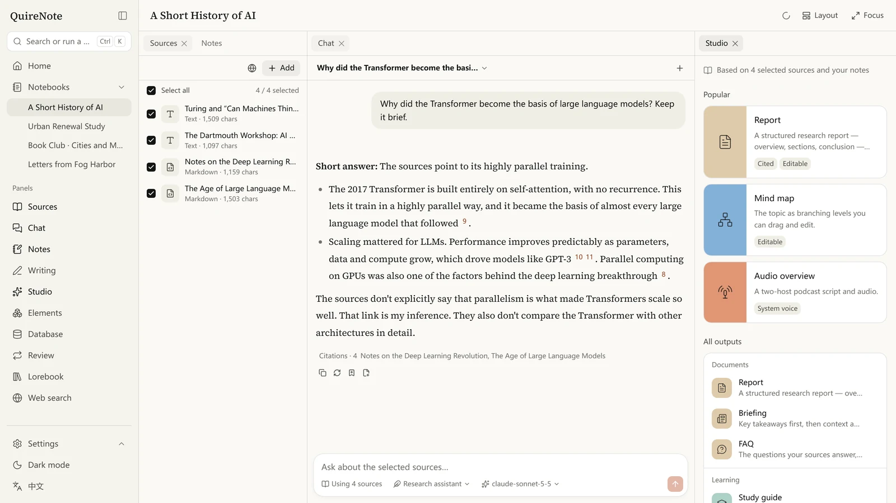
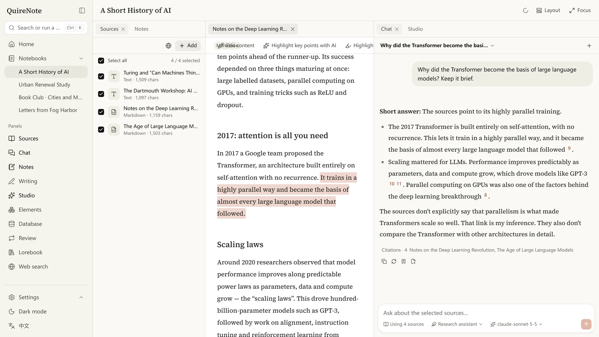
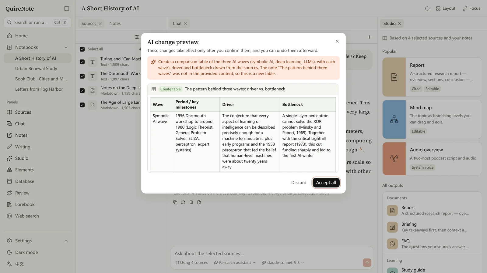
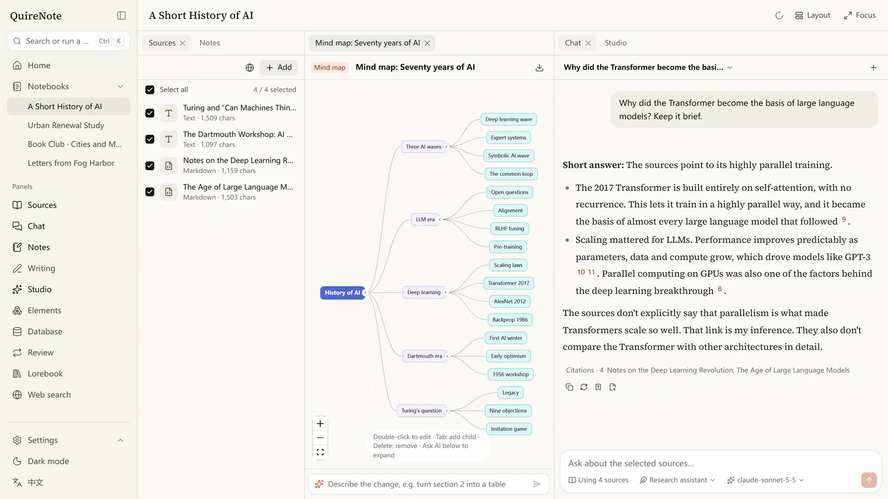
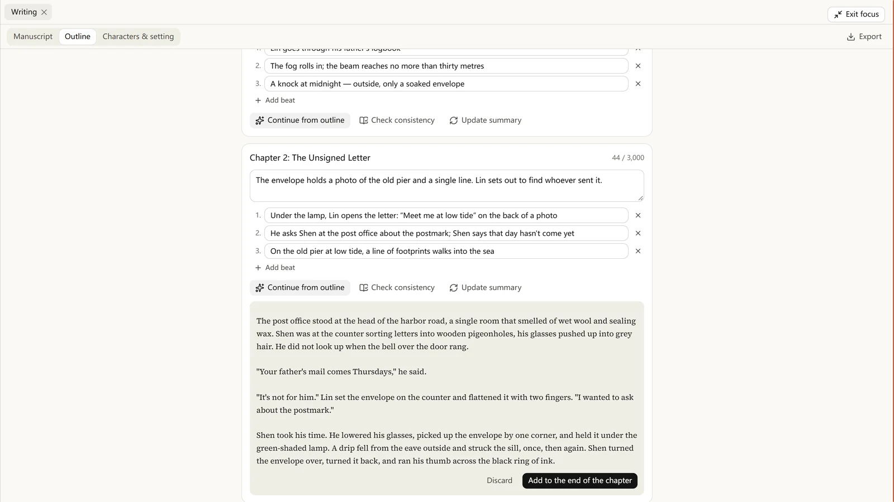
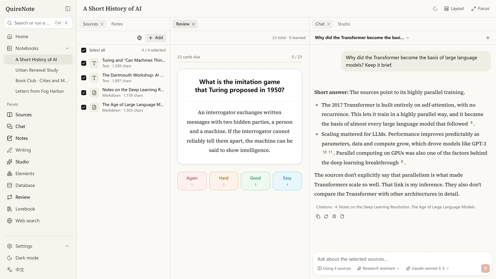
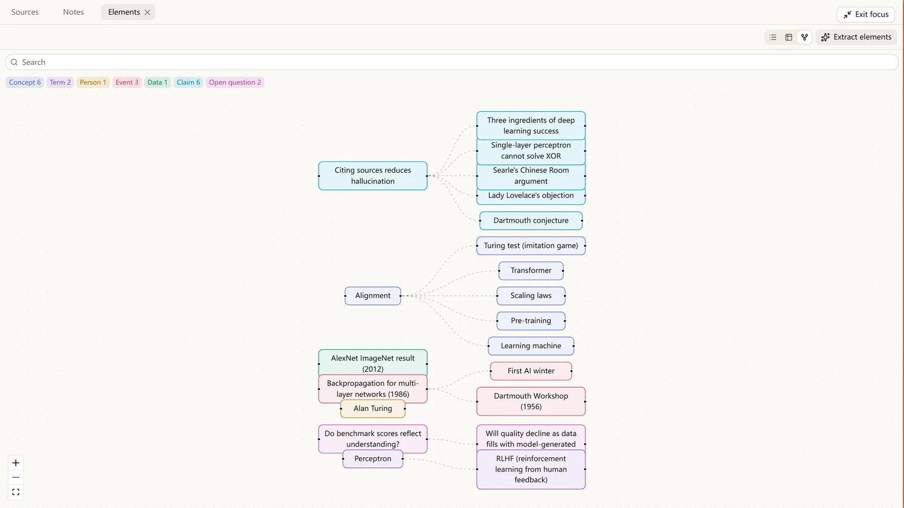

<div align="center">


# QuireNote

**A frontend-first, multi-model, self-hostable AI notebook.**<br>
Read your sources, ask with citations, write and learn — in one workspace you own.

[](https://github.com/Mar7thLover/QuireNote/actions/workflows/ci.yml)
[](LICENSE)
[](https://nodejs.org)
[](docs/mobile.md)
[](#docker)

**English** · [简体中文](README.zh-CN.md)

</div>

<br>

<picture>
  <source media="(prefers-color-scheme: dark)" srcset="docs/assets/screenshots/en/chat-dark.webp">
  
</picture>

QuireNote covers what NotebookLM does and aims to go further: a workspace you can split and rearrange, AI woven through the editor and the reader, every generated output editable, and a card rendering layer you can customize.

> **Quire** is a gathering of folded sheets sewn together — the basic unit of a bound book. Code, package names (`@quirenote/*`), environment variables (`QUIRENOTE_*`) and theme files (`.quirenote-theme`) all use this name.

## Highlights

- **Answers you can check.** Key claims carry citations. Hover to preview, click to jump to the highlighted sentence in the original.
- **AI where you write.** Select text to explain, rewrite or translate it. Press `Ctrl+K` and describe a change in plain words; it is previewed as a diff and applied only when you confirm.
- **Studio.** Reports, mind maps, flashcards, quizzes, slides, timelines, audio and video overviews — all editable afterwards.
- **Learn and write.** FSRS spaced repetition, extracted elements with a relationship graph, and novel projects with outlines, scene beats and consistency checks.
- **Any model.** Claude, OpenAI, Gemini, Ollama or any OpenAI-compatible endpoint, chosen per capability. A single Claude key is enough for every core feature.
- **Yours.** Self-hosted on SQLite, one `docker compose up`, keys encrypted at rest, plus iOS and Android apps that talk to your own server.

## Screenshots

<table>
  <tr>
    <td width="50%"></td>
    <td width="50%"></td>
  </tr>
  <tr>
    <td align="center"><sub>Every citation opens the exact sentence in the source</sub></td>
    <td align="center"><sub><code>Ctrl+K</code>: describe a change, review the diff, then apply</sub></td>
  </tr>
  <tr>
    <td></td>
    <td></td>
  </tr>
  <tr>
    <td align="center"><sub>Studio outputs stay editable</sub></td>
    <td align="center"><sub>Draft a chapter from its outline and scene beats</sub></td>
  </tr>
  <tr>
    <td></td>
    <td></td>
  </tr>
  <tr>
    <td align="center"><sub>Spaced repetition with FSRS</sub></td>
    <td align="center"><sub>Concepts, people and events as a relationship graph</sub></td>
  </tr>
</table>

## Features

| Area | What you get |
| --- | --- |
| Sources | PDF, URLs, plain text, Markdown, DOCX, EPUB, image OCR, audio and video transcription, YouTube captions. The reader offers the original side by side, ask-about-selection, highlights and annotations, excerpt cards, and AI-marked key points |
| Chat | Answers draw on the sources you tick and on the notebook's notes (notes count as sources). Key claims carry clickable citations: hover to preview, click to jump to the highlighted passage or open the note. The message tree supports branching, editing and regenerating; save any message as a card or note in one click |
| Editor | Tiptap block editor with `/` slash commands. Selected text gets an AI menu: explain, rewrite, expand, condense, translate, find the source, make questions. `Ctrl+J` runs your own instruction. Custom nodes for citations, cards and element tags; AI output is written in only after you confirm. Image, video and audio uploads, YouTube and Bilibili embeds, sandboxed HTML blocks, link previews and callouts; card syntax and custom rules render live as you type |
| Agent | The `Ctrl+K` command palette takes natural-language instructions. Every AI addition, edit or deletion is previewed as a diff, applied only after you confirm, and can be undone |
| Studio | Reports, briefings, study guides, FAQs, timelines, mind maps, flashcards, quizzes, data tables, infographics, slides, audio overviews, video overviews and illustrations. Everything is editable, and you can ask the AI to revise any part in plain language |
| Learning | FSRS spaced repetition. Flashcards, quizzes and elements join your review queue in one click, and mastery is written back to the elements |
| Elements | Extracts concepts, terms, people, events, dates, figures, arguments, formulas and open questions. View them as a list, table or relationship graph; merge them, add definitions, ask follow-ups, make cards in bulk, or trace them back to the source |
| Database views | Notes, sources, outputs and elements as tables, boards, galleries or calendars, with custom properties, filters, sorting and grouping |
| Custom rendering | Regex rules (run in a Web Worker with timeouts and ReDoS checks) and card templates in a sandboxed iframe (no scripts, strict CSP); simple inline templates render in place. 7 built-in templates, `.quirenote-theme` import and export, and global themes (colors, fonts, radius, density, background). Rules that come with a card apply only to its own notebook unless you make them global |
| Lorebook | Keyword-triggered background entries (constant entries, secondary-key logic, probability, groups, sticky / cooldown / delay, recursion, budget), inserted at chosen positions in chat and Studio prompts and never cited. Per-notebook AI instructions, a test panel, entries generated from elements, and an expandable list of the entries each answer used |
| Quire cards | Pack a single note or a whole notebook as a PNG (data hidden in the cover), JSON or `.quire`. A notebook card carries notes, sources (original files, full text, highlights), Studio outputs, elements and review cards, the lorebook and rendering rules, so it can be read and questioned right after import. Imports are previewed first. Spec: [docs/CARD_SPEC.md](docs/CARD_SPEC.md) (Chinese) |
| Writing | Novel projects: the manuscript is organized into parts and chapters (each chapter is a note), with drag-to-reorder, word counts and targets. Give each chapter a synopsis and scene beats, then draft from the outline or continue writing — the AI gets a recap of earlier chapters, this chapter's outline and the character notes that apply. Check consistency against your setting, summarize chapters, and keep characters, places, factions and items as lorebook entries. Export the manuscript to Markdown, Word or EPUB |
| Presets & templates | Chat presets (answering styles): built-in Research assistant, Plain explanation, Quiz me and Writing partner. Customize requirements, answer format, temperature and extra snippets, switch mid-conversation or set a notebook default; a notebook's AI instructions win on conflict. Note templates (reading notes, lecture notes, meeting notes, character profile, world entry) and notebook templates (research project, reading club, novel project); save any notebook or note as a template |
| Plugins | Optional features beyond the notebook, turned on as needed in Settings → Plugins; turning one off only hides it and leaves your data alone. Built in: **SillyTavern compatibility** — import character cards V1–V3 (PNG / JSON / CHARX) as a notebook or an answering style, world info, regex scripts and chat presets, and export a lorebook as world info. The import interface is ready for third-party plugins |
| Web search | Tavily, Brave or SearXNG. Add quick-search results to your sources in one click; deep research runs several rounds of searching, imports what it finds and writes a report |
| Models | Claude, OpenAI, Gemini, Ollama, OpenAI-compatible endpoints, ElevenLabs, fal, Replicate, ComfyUI and more. Pick a model per capability (chat, embedding, search, TTS, STT, image, video); each provider keeps its own model list and custom headers; switch models mid-conversation |
| Workspace | dockview panels and tabs you can split, drag and float. Layout presets (research, writing, learning, focus) plus your own, a focus mode, and on phones a bottom navigation bar with push-in detail pages |
| Context menus | Right-click offers actions for whatever is under the pointer: sources, notes, outputs, elements, chapters, notebooks and tabs each have their own menu. In the reader, selected text or a highlight offers ask, explain, recolor, annotate and excerpt. In the editor you get clipboard, AI, formatting, table rows and columns, block conversion and insert, plus actions specific to images, link previews and citations. Answers can be copied, quoted in a reply, read aloud, regenerated or saved as a card. The Menu key or `Shift+F10` opens it too; `Shift` + right-click shows the browser's own menu |
| Offline | The query cache persists to IndexedDB, so you can keep browsing offline; changes sync when the connection returns |

## Quick start

Requires Node 22.12+ and pnpm 11.

```bash
pnpm install
pnpm dev
```

- Web app: http://localhost:5173 (`/api` is proxied to port 8787)
- Server: http://localhost:8787/api/health
- The first launch creates a sample notebook, *A Short History of AI*. Reading, notes and search work without a model; chat, Studio and the other AI features need one.
- Add Claude, OpenAI, Gemini or Ollama in **Settings → Models and services**, or any OpenAI-compatible or Anthropic-compatible endpoint (proxies, DeepSeek, SiliconFlow, vLLM…). Add models by hand or fetch them from the service, then assign one to each capability. The bottom-left corner of the chat input switches the model for a single conversation.
- Claude alone covers every core feature: chat, web search (Claude's built-in search), reading images and vector illustrations (Claude draws SVG). Adding an Anthropic provider assigns chat, web search and illustrations automatically.
- Anthropic has no embedding API. Without embeddings, small selections of sources (up to roughly 60,000 characters) go to the model in full, with prompt caching to keep follow-up questions cheap; larger ones are searched full-text with queries the chat model expands from your question. For vector search, pick an embedding model from OpenAI, Gemini, Ollama or a compatible endpoint.
- Without a text-to-speech model, audio overviews are read by the browser's built-in voice.
- The home page shows this month's estimated spend (Claude at list prices), token usage over the last 7 days, words written and recently opened notes, and you can set a monthly budget. The built-in user guide is in the top-right corner of the home page.

### Docker

```bash
cp .env.example .env   # optional: add keys now, or later in the app
docker compose up -d --build
```

Open http://localhost:8787. Data is kept in the `quirenote-data` volume, and the server also serves the web app (`QUIRENOTE_WEB_DIST`).

### Configuration

See [.env.example](.env.example). The usual ones: `PORT`, `QUIRENOTE_DATA_DIR`, `QUIRENOTE_SECRET` (master key for encrypting API keys), `QUIRENOTE_SEED=0` (skip the sample notebook), `QUIRENOTE_JOB_CONCURRENCY`, `QUIRENOTE_LANG` (language for names created at startup; defaults to the system locale) and `FFMPEG_PATH`, plus providers added at startup such as `ANTHROPIC_API_KEY` (every key also accepts a `*_FILE` variant).

### Mobile

The iOS and Android apps are a Capacitor shell around the web build. They connect to your own QuireNote server and add a share-sheet target, file picking and recording. Build steps: [docs/mobile.md](docs/mobile.md) (Chinese).

## Development

| Command | What it does |
| --- | --- |
| `pnpm dev` | Start the web app and the server together |
| `pnpm lint` / `pnpm format` | Check / fix with Biome |
| `pnpm typecheck` | TypeScript strict-mode check across all packages |
| `pnpm test` | Vitest unit tests. AI calls go to a fake OpenAI-compatible model: deterministic, offline and free |
| `pnpm test:live` | Real-model tests that check prompts, citation rules and structured output with Claude Haiku. Needs `ANTHROPIC_API_KEY` or `ANTHROPIC_API_KEY_FILE` (skipped without one); `QUIRENOTE_LIVE_MODEL` picks another model |
| `pnpm e2e` | Playwright end-to-end tests. Starts its own server, web app and fake model service (`e2e/fake-llm.ts`) with the data directory `data-e2e` |
| `node scripts/tour.mjs [--dark]` | Screenshot tour of a running dev server, saved to `e2e/.screens/` |
| `node scripts/icons.mjs` | Regenerate the favicon and the iOS / Android icons and splash screens from one source |

Before the first E2E run: `pnpm exec playwright install chromium`.

### Project layout

```
apps/web         React 19 + Vite + TanStack Router/Query + Tailwind 4 + dockview + Tiptap + React Flow
apps/server      Hono (Node) + better-sqlite3 + sqlite-vec + FTS5, in-process job queue, SSE
apps/mobile      Capacitor shell (iOS / Android)
packages/core    Shared zod schemas, types and sample data
packages/ui      Design system: tokens, components, motion
packages/render  Regex rule engine, template rendering, HTML/CSS sanitizing, .quirenote-theme
packages/card    Quire card I/O (PNG tEXt / JSON / ZIP), import plugin interface, lorebook trigger engine
packages/plugin-sillytavern  Built-in plugin: character cards, world info, regex scripts, chat presets
packages/ai      Multi-provider layer on the Vercel AI SDK (with a fake OpenAI-compatible model for tests)
e2e/             Playwright end-to-end tests
docs/API.md      Client–server API contract (Chinese)
docs/CARD_SPEC.md  Quire card spec: fields, lorebook triggers, packaging, SillyTavern compatibility (Chinese)
```

### Design notes

- **Biome instead of ESLint + Prettier.** One fast tool for linting and formatting, one config for the whole monorepo.
- **dockview for the workspace.** Tabs, drag-to-split, floating groups and layout serialization out of the box.
- **No ORM in the storage layer.** The server defines repository interfaces, and the SQLite implementation uses better-sqlite3 directly: FTS5 virtual tables, sqlite-vec vector tables and triggers need hand-written SQL anyway. Moving to Postgres + pgvector means adding another repository implementation.
- **TypeScript 7 (native compiler), Vite 8, AI SDK 7.**

## Security

- API keys are stored encrypted with AES-256-GCM; no endpoint returns more than `hasKey` and the last four characters.
- Templates render in an iframe with `sandbox="allow-same-origin"` (no `allow-scripts`) and a strict CSP in `srcdoc`; HTML and CSS are sanitized first.
- Regex rules run in a Web Worker; a rule that runs longer than 300 ms is stopped and the worker is rebuilt.
- Imported cards are treated as untrusted. Rules and lorebook regex keys are checked for catastrophic backtracking and imported disabled if risky; lorebook entries are marked in prompts as background reference, not instructions; external images are downloaded as local assets; archives are checked for size and paths before extraction.
- Server CORS only allows local origins and Capacitor. It is single-user by default, with an `owner_id` reserved on every table.

## License

[MIT](LICENSE)
