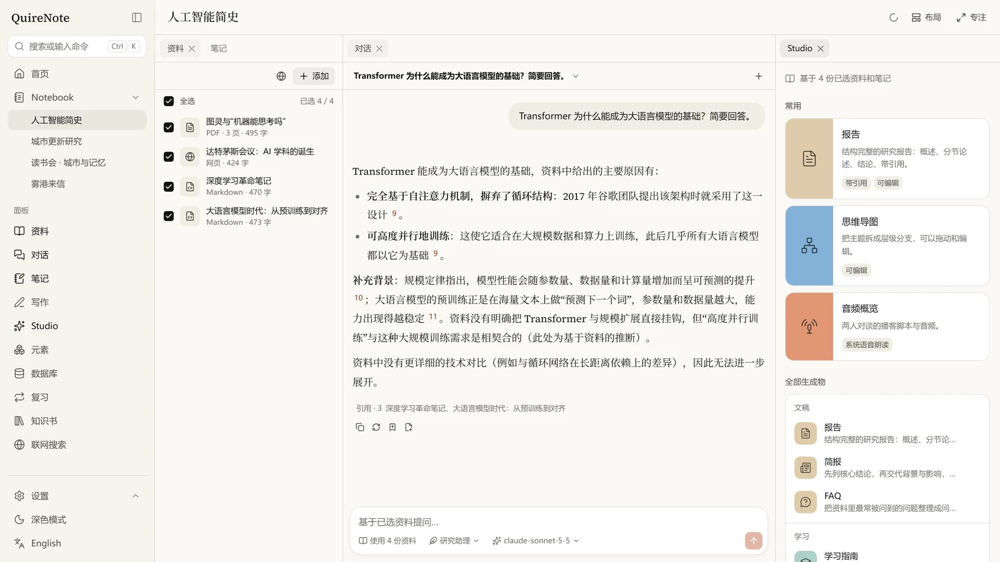
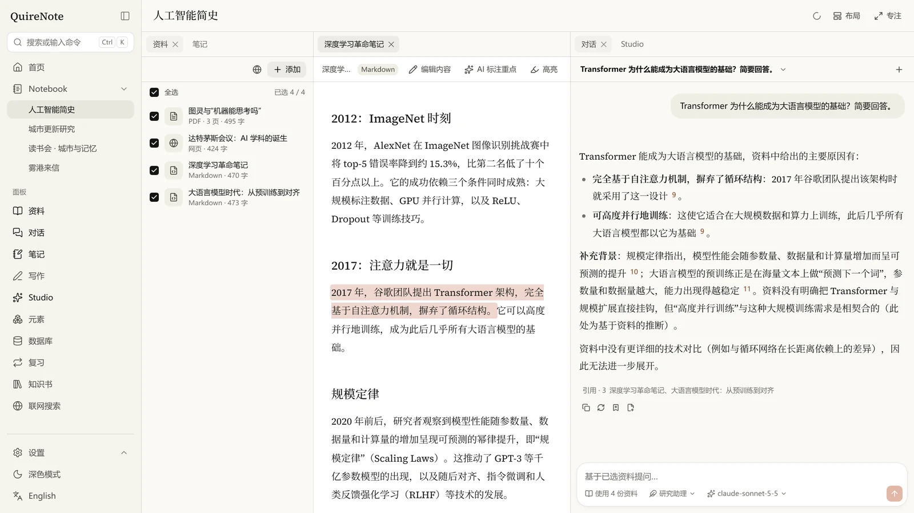
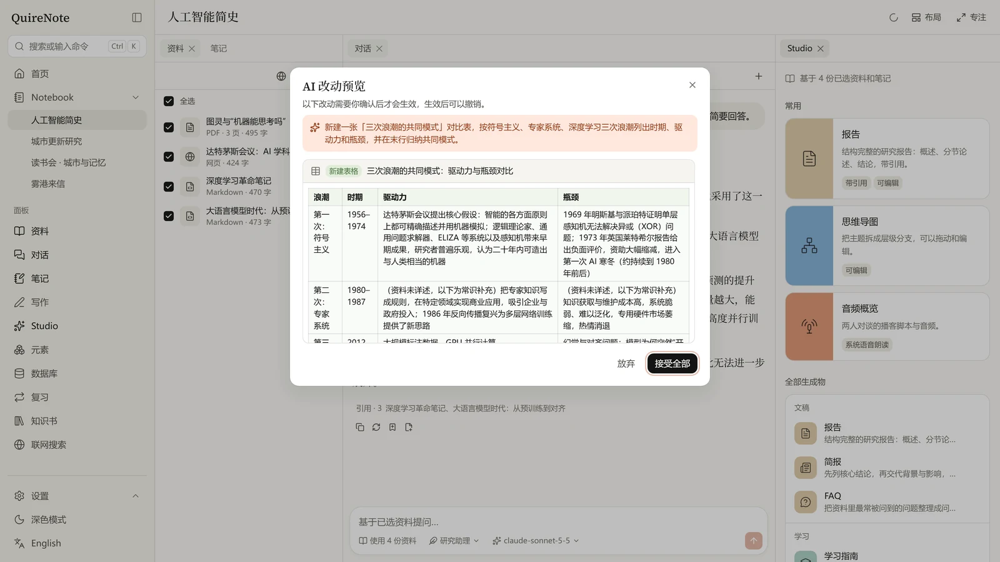
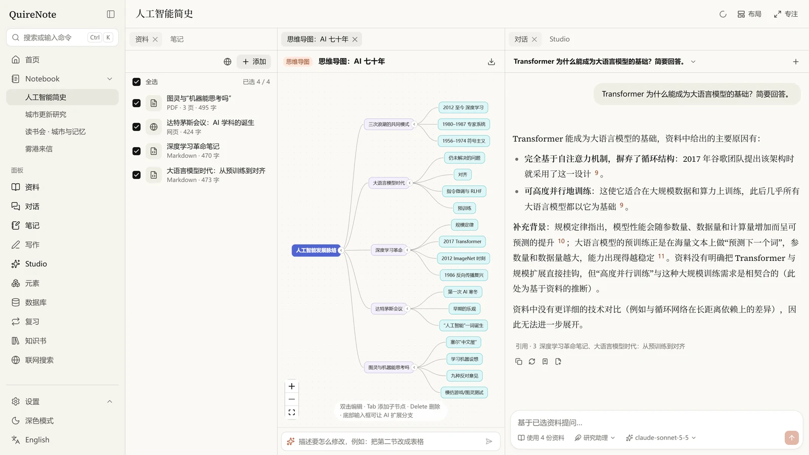
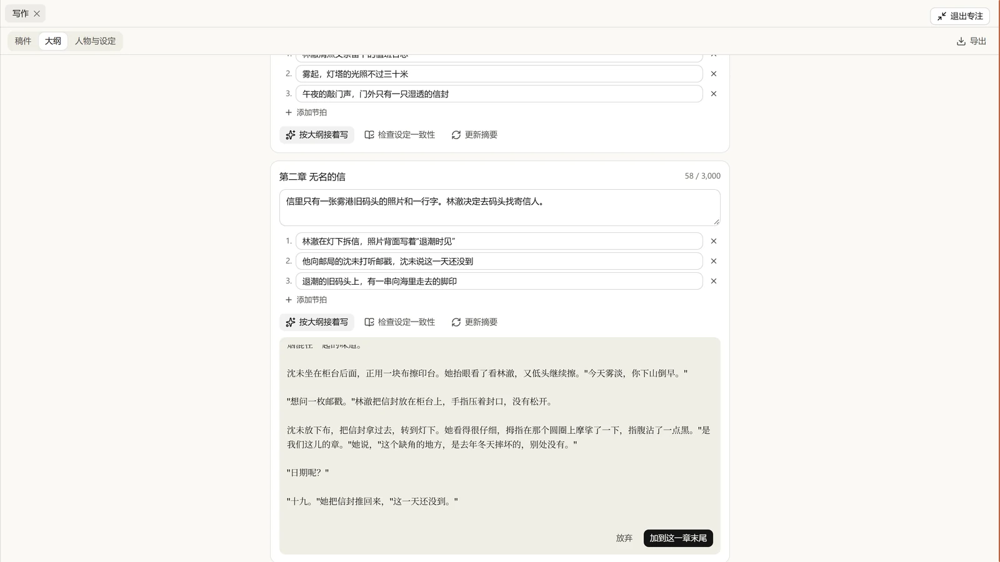
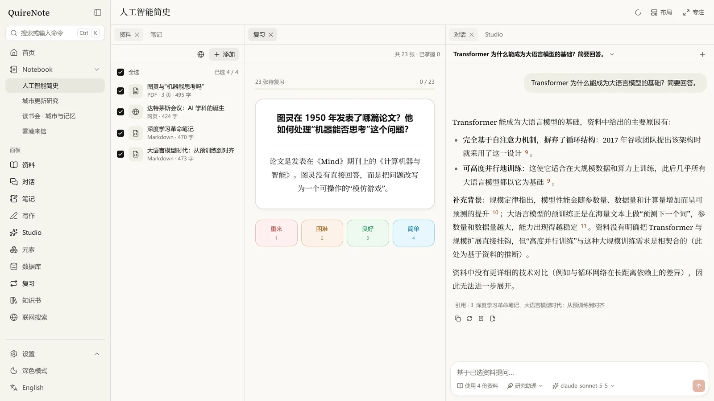
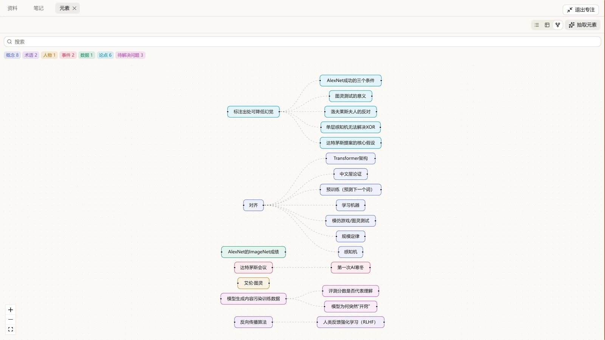

<div align="center">


# QuireNote

**前端优先、多模型、可自托管的 AI Notebook。**<br>
读资料、带引用地提问、写作与学习，都在一个属于你的工作区里。

[](https://github.com/Mar7thLover/QuireNote/actions/workflows/ci.yml)
[](LICENSE)
[](https://nodejs.org)
[](docs/mobile.md)
[](#docker-一键部署)

[English](README.md) · **简体中文**

</div>

<br>

<picture>
  <source media="(prefers-color-scheme: dark)" srcset="docs/assets/screenshots/zh/chat-dark.webp">
  
</picture>

功能对标 NotebookLM，体验上追求超越：可拆分的工作区、AI 贯穿编辑器与阅读器、所有生成物可编辑、可定制的卡片渲染层。

> QuireNote = quire（书帖，装订成册的一叠书页）+ note。代码、包名（`@quirenote/*`）、环境变量（`QUIRENOTE_*`）和主题文件（`.quirenote-theme`）统一使用这个名字。

## 亮点

- **回答可以核对**：关键结论带引用，悬浮预览，点一下跳到原文里高亮的那一句。
- **AI 就在写字的地方**：选中文字即可解释、改写、翻译；`Ctrl+K` 用一句话描述改动，先看 diff 预览，确认后才生效。
- **Studio**：报告、思维导图、闪卡、测验、幻灯片、时间线、音频与视频概览，生成后都能继续编辑。
- **学习与写作**：FSRS 间隔重复、元素抽取与关系图；小说项目有大纲、场景节拍和一致性检查。
- **模型随你选**：Claude、OpenAI、Gemini、Ollama 或任意 OpenAI 兼容接口，按能力分别指定；只配一个 Claude 就能用全部核心功能。
- **数据在你手里**：SQLite 自托管，一条 `docker compose up` 部署，Key 加密存储；iOS / Android 客户端连接你自己的服务器。

## 截图

<table>
  <tr>
    <td width="50%"></td>
    <td width="50%"></td>
  </tr>
  <tr>
    <td align="center"><sub>每个引用都能打开原文里的那一句</sub></td>
    <td align="center"><sub><code>Ctrl+K</code>：说一句话，看过 diff 再生效</sub></td>
  </tr>
  <tr>
    <td></td>
    <td></td>
  </tr>
  <tr>
    <td align="center"><sub>Studio 生成物都可编辑</sub></td>
    <td align="center"><sub>按本章大纲和场景节拍起草</sub></td>
  </tr>
  <tr>
    <td></td>
    <td></td>
  </tr>
  <tr>
    <td align="center"><sub>FSRS 间隔重复</sub></td>
    <td align="center"><sub>概念、人物、事件连成关系图</sub></td>
  </tr>
</table>

## 功能一览

| 模块 | 内容 |
| --- | --- |
| 资料 | PDF / URL / 文本 / Markdown / DOCX / EPUB / 图片 OCR / 音视频转写 / YouTube 字幕；阅读器支持原文对照、划词提问、高亮批注、摘录卡片、AI 标注重点 |
| 对话 | 依据勾选的资料和这本的笔记回答（笔记也算资料），关键结论带可点击引用（悬浮预览、跳转原文高亮或打开笔记）；消息树支持分支、编辑、重新生成；任意消息一键存为卡片 / 笔记 |
| 编辑器 | Tiptap 块编辑；`/` 斜杠命令；选中文字弹出 AI 菜单（解释、改写、扩写、精简、翻译、找出处、出题）；`Ctrl+J` 自定义指令；引用 / 卡片 / 元素标签等自定义节点；AI 结果需确认后写入；图片 / 视频 / 音频上传、YouTube 与 Bilibili 嵌入、沙箱 HTML 块、链接预览、提示框；卡片语法与自定义规则在编辑器里即时渲染 |
| Agent | `Ctrl+K` 命令面板支持自然语言操作，AI 的增删改先以 diff 预览，确认后生效，并可撤销 |
| Studio | 报告、简报、学习指南、FAQ、时间线、思维导图、闪卡、测验、数据表格、信息图、幻灯片、音频概览、视频概览、配图；全部可编辑，可用自然语言让 AI 修改局部 |
| 学习 | FSRS 间隔重复复习；闪卡、测验、元素可一键加入复习，掌握度回写到元素 |
| 元素分析 | 抽取概念、术语、人物、事件、日期、数据、论点、公式、问题；列表 / 表格 / 关系图；合并、补充定义、追问、批量出卡、回溯出处 |
| 数据库视图 | 笔记 / 资料 / 生成物 / 元素都可用表格、看板、画廊、日历查看，支持自定义属性、筛选、排序、分组 |
| 自定义渲染 | 正则规则（Web Worker 执行 + 超时 + ReDoS 检测）+ 沙箱 iframe 卡片模板（禁脚本、严格 CSP），句中的简单模板原地渲染；内置 7 套模板；`.quirenote-theme` 导入导出；全局主题（配色、字体、圆角、密度、背景）；卡片带来的规则只对自己的 Notebook 生效，可设为全局 |
| 知识书 | 关键词触发的背景条目（常驻、次关键词逻辑、概率、分组、保持 / 冷却 / 延迟、递归、预算），按位置插入对话与 Studio 提示词，不进引用；每本 Notebook 的 AI 说明；测试栏；从元素生成；回答下方可展开用到的条目 |
| Quire 卡 | 单条笔记或整本 Notebook 打包成 PNG（数据藏在封面里）/ JSON / `.quire`：整本卡带上笔记、资料（原文件、全文、高亮）、Studio 生成物、元素与复习卡、知识书和渲染规则，导入后直接能读、能提问；导入先预览。规格见 [docs/CARD_SPEC.md](docs/CARD_SPEC.md) |
| 写作 | 小说项目：稿件按卷章组织（每章就是一篇笔记），拖拽排序、字数与目标；每章写梗概和场景节拍，按大纲起草或接着写（AI 带上前文提要、本章大纲和触发的人物设定）；对照设定检查一致性；章节摘要；人物、地点、势力、物品就是知识书条目；整部稿件导出 Markdown / Word / EPUB |
| 预设与模板 | 对话预设（回答风格）：内置研究助理、通俗讲解、提问式复习、写作搭档，可自定义要求、回答格式、温度等参数和附加片段，在对话里随时切换或设为一本的默认，与 AI 说明冲突时以 AI 说明为准；笔记模板（读书、课程、会议、人物小传、世界观条目）；Notebook 模板（研究课题、读书会、小说项目），任意 Notebook 或笔记都能存为模板 |
| 插件 | 笔记本之外的可选功能，在「设置 → 插件」按需开启，关掉只隐藏入口、不动数据。内置「酒馆兼容」：读取酒馆（SillyTavern）角色卡 V1–V3（PNG / JSON / CHARX，可导入为 Notebook 或问答风格）、世界书、正则脚本和对话预设，知识书可导出为世界书；导入接口为以后的第三方插件预留 |
| 联网搜索 | Tavily / Brave / SearXNG，快速搜索结果一键加入资料；深度研究多轮检索后自动导入并出报告 |
| 模型 | Claude、OpenAI、Gemini、Ollama、OpenAI 兼容、ElevenLabs、fal、Replicate、ComfyUI 等；按能力（对话 / Embedding / 搜索 / TTS / STT / 图像 / 视频）分别指定；每个提供方可登记自己的模型列表、自定义请求头；对话里可随时切换模型 |
| 工作区 | dockview 可拆分、拖拽、浮动的面板与标签页；布局预设（研究 / 写作 / 学习 / 专注）和自定义预设；专注模式；移动端底部导航 + 推入式详情页 |
| 右键菜单 | 按右键的位置给出对应操作：资料、笔记、生成物、元素、章节、Notebook、标签页各有自己的菜单；阅读器里选中文字或点在高亮上可提问、解释、改色、批注、摘录；编辑器里有剪贴板、AI、格式、表格行列、转换块类型、插入，点在图片 / 链接预览 / 引用上是它们自己的操作；对话回答可复制、引用回复、朗读、重新生成、存为卡片；任意位置选中文字、链接、图片、输入框都有通用操作。菜单键 / `Shift+F10` 也能打开，`Shift` + 右键是浏览器原生菜单 |
| 离线 | 查询缓存持久化到 IndexedDB，离线可浏览；连接恢复后自动同步 |

## 快速开始

需要 Node 22.12+ 和 pnpm 11。

```bash
pnpm install
pnpm dev
```

- 前端：http://localhost:5173（`/api` 自动代理到 8787）
- 服务端：http://localhost:8787/api/health
- 首次启动会创建一个示例 Notebook「人工智能简史」。阅读、笔记、检索不需要模型；对话、Studio 等 AI 功能需要先配置模型。
- 在「设置 → 模型与服务」添加 Claude / OpenAI / Gemini / Ollama，或任意 OpenAI 兼容、Anthropic 兼容接口（中转、DeepSeek、硅基流动、vLLM 等）；在提供方下手动添加或「从服务拉取」模型，再为每种能力分配。对话输入框左下角可以给单个对话切换模型。
- 只配一个 Claude 就能用全部核心功能：对话、联网搜索（Claude 自带 web search）、读图、矢量插图（Claude 绘制 SVG）。添加 Anthropic 后，对话 / 联网搜索 / 插图会自动分配。
- Anthropic 没有 Embedding 接口。没有 Embedding 时：所选资料不多（约 6 万字以内）就整份交给模型阅读，并用提示词缓存降低连续提问的费用；资料多时由对话模型把提问扩展成多组检索词再做全文检索。需要向量检索时选 OpenAI、Gemini、Ollama 或兼容接口的 Embedding 模型。
- 没有语音合成（TTS）时，音频概览用浏览器自带的系统语音朗读。
- 首页显示本月估算花费（Claude 按官方标价）、最近 7 天 Token 用量、写作字数和最近打开的笔记；可以设置月度预算。内置使用手册在首页右上角。

### Docker 一键部署

```bash
cp .env.example .env   # 可选：填入 Key，或之后在界面里添加
docker compose up -d --build
```

访问 http://localhost:8787。数据保存在 `quirenote-data` 卷中。服务端会同时托管前端页面（`QUIRENOTE_WEB_DIST`）。

### 环境变量

见 [.env.example](.env.example)。常用：`PORT`、`QUIRENOTE_DATA_DIR`、`QUIRENOTE_SECRET`（Key 加密主密钥）、`QUIRENOTE_SEED=0`（不建示例数据）、`QUIRENOTE_JOB_CONCURRENCY`、`QUIRENOTE_LANG`（启动时自动起名用的语言，默认按系统区域设置）、`FFMPEG_PATH`；以及 `ANTHROPIC_API_KEY` 等启动时自动添加的 Provider（均支持 `*_FILE`）。

### 移动端

iOS / Android 客户端是 `apps/web` 构建产物的 Capacitor 原生壳，连接你自托管的 QuireNote 服务器，另有系统分享菜单、文件选择和录音。构建步骤见 [docs/mobile.md](docs/mobile.md)。

## 开发

| 命令 | 作用 |
| --- | --- |
| `pnpm dev` | 同时启动 web 与 server |
| `pnpm lint` / `pnpm format` | Biome 检查 / 自动修复 |
| `pnpm typecheck` | 全部包的 TypeScript 严格模式检查 |
| `pnpm test` | Vitest 单元测试（AI 调用走假的 OpenAI 兼容模型，确定、离线、不花钱） |
| `pnpm test:live` | 真实模型测试：用 Claude Haiku 检验提示词、引用规则和结构化输出。需要 `ANTHROPIC_API_KEY` 或 `ANTHROPIC_API_KEY_FILE`，没有时整组跳过；`QUIRENOTE_LIVE_MODEL` 可换模型 |
| `pnpm e2e` | Playwright 端到端测试（自动启动独立的服务端、前端和假模型服务 `e2e/fake-llm.ts`，数据目录 `data-e2e`） |
| `node scripts/tour.mjs [--dark]` | 对运行中的开发服务器做界面巡检截图，输出到 `e2e/.screens/` |
| `node scripts/icons.mjs` | 从同一份源重新生成 favicon、iOS / Android 图标和启动图 |

首次运行 E2E 前需要 `pnpm exec playwright install chromium`。

### 目录结构

```
apps/web         React 19 + Vite + TanStack Router/Query + Tailwind 4 + dockview + Tiptap + React Flow
apps/server      Hono (Node) + better-sqlite3 + sqlite-vec + FTS5，进程内任务队列，SSE 推送
apps/mobile      Capacitor 壳（iOS / Android）
packages/core    共享 zod schema 与类型、示例数据
packages/ui      设计系统：tokens、组件、动效
packages/render  正则规则引擎、模板渲染、HTML/CSS 清洗、.quirenote-theme
packages/card    Quire 卡读写（PNG tEXt / JSON / ZIP）、导入插件接口、知识书触发引擎
packages/plugin-sillytavern  内置插件「酒馆兼容」：角色卡、世界书、正则脚本、对话预设的转换
packages/ai      基于 Vercel AI SDK 的多 Provider 抽象（含测试用的假 OpenAI 兼容模型）
e2e/             Playwright 端到端测试
docs/API.md      前后端接口契约
docs/CARD_SPEC.md  Quire 卡规格（字段、知识书触发规则、封装、与酒馆的兼容）
```

### 技术选型说明

- **Biome 代替 ESLint + Prettier**：一个工具同时负责 lint 和格式化，速度快，monorepo 只需一份配置。
- **dockview 作为工作区面板**：原生支持标签页、拖拽拆分、浮动组和布局序列化。
- **存储层没有使用 ORM**：服务端定义了 repository 接口，SQLite 实现直接使用 better-sqlite3。FTS5 虚表、sqlite-vec 向量表和触发器都需要手写 SQL，ORM 带来的收益有限。要换成 Postgres + pgvector 时，新增一个 repository 实现即可。
- **TypeScript 7（原生编译器）**、**Vite 8**、**AI SDK 7**。

## 安全

- API Key 用 AES-256-GCM 加密存储，任何接口都只返回 `hasKey` 和末四位。
- 模板在 `sandbox="allow-same-origin"`（无 `allow-scripts`）的 iframe 中渲染，srcdoc 带严格 CSP，HTML/CSS 先经过清洗。
- 正则在 Web Worker 中执行，单条规则超时 300ms 即终止并重建 Worker。
- 导入的卡片按不可信内容处理：规则与知识书正则键做回溯风险检测，有风险的导入为停用；知识书条目在提示词里标明是背景参考而非指令；外链图片下载为本地资源；解压前检查大小与路径。
- 服务端 CORS 只放行本机来源和 Capacitor；默认单用户，所有表预留 `owner_id`。

## 许可

[MIT](LICENSE)
